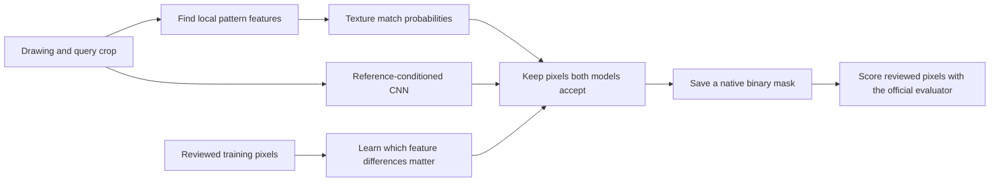

# Hatch matching system

## Goal and completion gates

Build reproducible label-free inference for the TruTec Hatch Matching Challenge. Public validation must measure at least 0.75 document-macro IoU and at least 0.95 pooled recall, with precision and reviewed-blank false positives reported. Private-test results require organizer evaluation and must remain separate. Do not change the upstream evaluator, dataset, annotations, or exclusions. Predictions must be binary PNGs at native dimensions for every request.

Use compute-box for training and inference. Fireworks spending may not exceed $50; record actual charges before claiming budget use. Pretrained models and external training data are allowed subject to licensing and disclosure. Prepare a submission email draft; do not send it or push without authorization.

## Plan

1. Verify upstream contracts, dataset integrity, hardware, and CLI access. Inspect training examples and annotation coverage before choosing a model.
2. Research relevant external models and datasets with license evidence. Establish a measured classical texture baseline and a document-separated training development split.
3. Improve the baseline from measured errors. Compare pretrained texture features and a learned query-conditioned matcher where evidence warrants them. Record each experiment's configuration, data use, runtime, metrics, success, failure, and pivot.
4. Freeze the selected pipeline and run all 57 public validation queries with the unchanged evaluator. Report all scores and counts, disclose any validation-guided development, and keep working if either performance gate fails.
5. Verify inference integrity, type checks, meaningful tests, and complexity <=15 for new code. Save artifacts, reproducibility instructions, visual failure cases, licenses, and email draft. Commit verified features locally. Clean up agent and compute processes.

| Task | Model tier and owner |
|---|---|
| External model and training-data research | Gemini CLI and Cursor/Grok |
| Dataset inspection, baseline implementation, experiment utilities, tests | Cursor/Grok and Gemini CLI |
| Architecture, trust boundaries, experiment selection, independent verification | GPT Sol coordinator |
| Repetitive runs and measurement | Python on compute-box |

## Verified state

- Upstream revision: `65b98e480f2a10b82f974f4feb519ee4e012d66c`; isolated branch `codex/hatch-matching-system`.
- The scorer uses only reviewed pixels, excludes query/context rectangles, and averages query IoU within documents before averaging documents. Unknown pixels cannot establish whole-sheet accuracy.
- Local Gemini 0.63.0 and Cursor agent 2026.10.01-e373342 launch successfully. Cursor advertises Grok 4.7 and Gemini models; authenticated inference is still to be verified.
- compute-box is reachable over SSH. It is an arm64 Mac with 16 GiB RAM, 8 logical CPUs, and about 19 GiB free storage. Its noninteractive PATH exposes only system Python; runtime discovery is next.
- Public dataset download started with the official checksum-verifying downloader.

## Checkpoint 1: data, hardware, and research

- Official dataset download completed locally and was transferred to compute-box; both copies pass the upstream file checksum verification (734 entries).
- compute-box: Apple M1 Pro, 14 GPU cores, 16 GiB RAM, macOS 26.3. PyTorch 2.14.1 reports MPS available. Installed isolated Python 3.11.16 runtime and inference/test dependencies; no paid compute provisioned.
- Upstream checks on compute-box: `RUN_IMAGE_TESTS=1 .venv/bin/python -m pytest -q` passed 16 tests plus 29 subtests, with no image-test skips.
- Deterministic training-only development split: fitting 357 queries / 105 document groups; development 91 queries / 21 groups; real-only development 55 queries / 12 groups. No overlap. Public validation has not been used for model selection.
- Inspected 24 real training queries with positive and negative examples. Patterns include gray fills, directional lines, crosshatch, hexagons, dots, irregular marks, and queries overlaid by text/boundaries. This motivates complementary patch and texture features.
- Failure: standalone Gemini CLI requests fail with `IneligibleTierError` because the Code Assist client is no longer supported. Pivot: Gemini 3.8 Flash High via Cursor, as explicitly requested by the user. The research task completed; learned-matcher implementation is assigned to the same model.
- Cursor/Grok 4.7 High is researching external datasets and implementing native texture/template features in separate file ownership scopes. CLI logs retained under `agent-logs/`; model-provider costs are not yet available, and no dollar cost is invented. Fireworks spend: $0.
- Reviewed Gemini research against primary sources. Corrected benchmark/task mismatches and unsupported guarantees in `RESEARCH_REVIEW.md`. Research accuracy does not count as challenge performance.

## Experiment record

No model performance has been measured yet. No performance target is achieved.

## Checkpoint 2: pretrained candidate and MPS correction

- Grok research found HatchFinder, a reference-conditioned hatch segmentation model. Independently verified Apache-2.0 code and weights, pinned revisions, byte length, and SHA-256; provenance recorded in `external-resources.json`.
- Original 3.5M model loads on compute-box and produces finite 256x256 logits with a 48x48 query on MPS. This is a plumbing smoke test, not accuracy evidence.
- Failure: native 36x36, 46x46, 48x64, and 32x48 query crops fail MPS adaptive pooling. 72x72 succeeds. Changing crop size/pitch to bypass the failure would change the query distribution.
- Fix: extend the pinned library's matching-vector layer in `hatchfinder_mps.py`; only nondivisible query pooling executes on CPU, preserving the original adaptive-pooling operation. Drawing features remain on MPS. Two CPU/MPS equivalence and gradient tests pass; mypy passes; maximum function complexity is 5.
- Gemini 3.8 Flash High is implementing the learned texture matcher/training/inference/tests. Grok 4.7 High is implementing native template/texture features and the pretrained tile adapter. Real training and challenge inference have not started; no score is claimed.

## Checkpoint 3: verified baseline implementations

- Grok finished native template matching and 46-channel phase-invariant texture descriptors. Gemini finished the learned pair classifier, training script, label-free inference, and tests. File ownership remained separate.
- On compute-box, 22 baseline/learning tests and 12 subtests passed. Mypy passed all four matcher modules; maximum function complexity is 8. The core matcher never opens annotations; only the training/evaluation programs consume reviewed domains.
- The MPS bridge successfully processed a real 36x36 development query on a native 896x896 tile, producing finite logits. The smoke forward took 0.895 seconds and reported 5,992 MB MPS driver allocation at that point; this is neither peak resident memory nor a complete-query runtime.
- Local commit `e5cb021` records verified model download/integrity and MPS compatibility. No push. Research-derived trained weights remain a candidate until measured.

Training annotations feed model fitting and scoring, never the inference input path.

## Experiment starts

- `template-development-v1`: sweep thresholds 0.35–0.95 on all 55 real training-development queries with native responses and the upstream confusion-count/aggregation functions. Log and per-query JSONL are on compute-box under `artifacts/`. This is development, not public validation.
- `texture-hgb-v1`: 46 descriptor channels, stride 4, up to 512 reviewed positive and 512 reviewed negative centers per query, 200 gradient-boosting iterations, seed 42; fit on the 357 fitting queries only. Per-query class weights sum to one; annotations are excluded from inference. CPU thread limits are 2 to coexist with the template sweep.
- Verified baseline/pipeline commit: `f91bbce`. No push. Fireworks spend remains $0.
- Both experiments started on compute-box. No training or validation performance result is available yet.

## Experiment result: template-development-v1 failed the gates

All 55 real development queries across 12 held-out training documents were scored. Runtime: 166.09 seconds, including the nine-threshold sweep and reviewed-domain scoring. Best tested document-macro IoU occurred at threshold 0.35: **0.4272356724 IoU**, **0.6069276630 pooled recall**, **0.2412859483 pooled precision**. No tested operating point meets either requested gate together. Three examples are positive-only. Reviewed-blank false positives are null because no explicit eligible blank labels were supplied; null is not zero error.

Failure: small template correlation does not cover enough matching texture and accepts competing linework. Pivot: retain this as a measured baseline, continue learned phase-invariant descriptors and native tiled HatchFinder. Threshold selection used training development only. Raw per-query counts, complete summaries, manifest hash, and implementation hash are in `artifacts/template-development-v1/`.

Corrected native interpolation at odd image edges so the final clamped grid center retains its own probability. Regression test passes, as do all eight learned-matcher tests, mypy, and complexity lint. This correction affects inference remapping, not the in-progress training descriptors or fitting data.

## Checkpoint 4: exact development scoring and native pretrained adapter

- Trained texture HGB completed on compute-box: 357 fitting queries / 105 groups, 331,422 sampled pairs, 294.60 seconds. No development or validation labels entered fitting.
- Connected native HatchFinder tile adapter to the verified MPS query-pooling bridge. Remote proof: 15 adapter/model-integrity/pooling tests passed; mypy passed both modules; Ruff complexity checks passed. Native pixels, all-ones search masks, binary output, edge coverage, and malformed outputs are tested.
- Gemini 3.8 Flash High completed exact selective texture scoring. Independent remote proof: seven tests passed, including sparse/full remapping equivalence on odd dimensions and official evaluator count agreement; mypy and complexity passed. Saved reviewed-pixel probabilities support later analysis without repeated inference. These are scoring artifacts, not complete prediction masks.
- Started all 55 real development query texture sweep on compute-box. Public validation remains unused for selection.
- User now authorizes agent swarms and requests new Gemini work through Antigravity instead of Cursor. Antigravity route discovery is in progress; the already-running Cursor Gemini task completed, and no new Cursor Gemini task is launched.

| Task | Model tier and owner |
|---|---|
| Antigravity CLI discovery | Luna worker |
| Exact HatchFinder development scorer and tests | Luna worker |
| Fine-tuning feasibility if pretrained candidate fails | Luna worker |
| Existing texture scorer implementation | Gemini 3.8 Flash High via Cursor, completed |
| Integration, data boundaries, remote verification and selection | Sol coordinator |

Fireworks spending remains $0. Provider CLI and subagent costs are not available.

## Experiment result: texture-hgb-v1 also failed the joint gates

All 55 real training-development queries / 12 documents completed in 54.79 seconds, including feature extraction and exact reviewed-pixel scoring. At threshold 0.60, document-macro IoU was 0.6624318182678043, pooled recall 0.7563 and pooled precision 0.4200. At threshold 0.20, recall reached 0.9506 but IoU was 0.5165 and precision 0.2131. No tested operating point meets both gates. Selection still uses training development only.

Pivot: measure the exact-task pretrained HatchFinder candidate; request bounded Gemini failure analysis of the learned texture model using authenticated Antigravity `agy --model gemini-3.8-flash-high --effort high`. Raw provider logs remain private/ignored. Development probability vectors are retained for exact subsequent calibration analysis. They are not native inference masks. Fireworks spending: $0.

## Checkpoint 5: pretrained experiment started

- Luna implemented the exact HatchFinder development scorer. Remote proof: all four tests passed, including nonconstant sparse/full tile probability equivalence across seams and skipped-tile correctness; mypy and Ruff passed. No torch-test skips remotely.
- Started all 55 real held-out training queries on compute-box with pretrained pinned weights, native 896-pixel tiles, 128 overlap, and the MPS bridge. It retains sparse development probabilities and official threshold-count summaries, not submission masks.
- Luna inspected fine-tuning APIs. Gemini 3.8 Flash High via Antigravity is implementing a minimal fallback trainer with frozen image/query encoders, native crops, document-balanced sampling, and loss masking. Real fine-tuning has not started; pretrained measurement determines whether to use it.

| Task | Model tier and owner |
|---|---|
| Native pretrained scorer implementation and tests | Luna worker, completed |
| Masked fine-tuning fallback implementation | Gemini 3.8 Flash High via Antigravity |
| Texture failure analysis | Gemini 3.8 Flash High via Antigravity |
| Experiment decision and independent verification | Sol coordinator |

Fireworks spending remains $0; other provider dollar costs unavailable.

## Experiment result: pretrained HatchFinder failed the gates

All 55 real development queries / 12 documents completed in 196.93 seconds. Best tested IoU occurred at threshold 0.01: document-macro IoU 0.3149920681911573, pooled recall 0.4206001589825119, pooled precision 0.3320447692351138. At threshold 0.50, IoU was 0.2710672814130296 and recall 0.2839825119236884. This is inadequate and cannot be the final system.

Verified preprocessing matches the pinned package: RGB [0,1], sigmoid, variable native hatch crops. The model card specifies training drawings at 896×896; no evidence requires resizing hatch crops to 128/256. Native 36×36 queries produce 9×9 deepest query features (effective stride4), not 5×5. Small crops alone do not establish the cause of poor generalization.

Pivot: supervised masked adaptation on fitting documents only, plus a bounded HGB query-self-calibration experiment. The Gemini failure-analysis report mixes measured counts with causal hypotheses; treat contamination/feature limitations as hypotheses until controlled experiments. No public validation labels used for selection. Fireworks spending remains $0.

## Experiment result: query-self calibration improved recall tradeoff, still failed

Evaluated 96 quantile/scale/offset formulas over all 55 real training-development queries. Remote mypy and Ruff passed; the experiment's baseline aggregate summaries exactly match every original texture-development threshold. Runtime 46.98 seconds. Formula is clip(scale × input-query self-score quantile + offset, 0.01, 0.99); it uses no labels during inference.

Peak IoU setting median×0.9−0.2: IoU 0.6727160898793101, recall 0.8208525437201908, precision 0.3231968438752667. Best tested setting with recall≥0.95 was q10×0.7−0.1: IoU 0.6234508855814777, recall 0.9508366454689984, precision 0.2243138530837816. Neither meets both gates. These formulas were selected on training development only; no public validation tuning occurred.

## Checkpoint 6: native masked training pilot passed

Gemini 3.8 Flash High through Antigravity completed the fallback trainer. Nine remote tests passed, mypy and Ruff passed. Tests prove ignored pixels have zero loss gradient, supplied query pixels retain native pitch, annotations stay out of model input masks, and checkpoints use the pinned deployment format. Integration review extended split protection to all development documents and records actual update count, code hash, and output hash.

A real 10-step MPS pilot at 896×896 finished successfully in 21.47 seconds total; 2,162,076 parameters trainable with both encoders frozen. `/usr/bin/time -l` reported maximum resident set size 1,153,908,736 bytes and peak memory footprint 10,957,296,512 bytes. These are distinct measurements; the latter is not peak RSS. No convergence/accuracy claim follows from this pilot.

Started `hatchfinder-adapt-v1`: 200 document-balanced native 896-pixel updates, AdamW lr=1e-4, seed42, fit partition only, reviewed masked BCE+Dice, fixed input mask of ones. This bounded stage tests adaptation before a longer run; native drawing size matches the pretrained model's documented training size. Checkpoint after100 updates. Development evaluation will run after training releases MPS memory.

Grok 4.7 High is implementing a controlled HGB crop-descriptor experiment: texture statistics computed from the exact query crop, preventing outside-query content from entering those statistics. The original drawing descriptor remains the default for legacy weights, and a shared helper keeps training/inference/scoring consistent. Hypothesis, not a promised improvement.

| Task | Model tier and owner |
|---|---|
| Masked trainer implementation | Gemini 3.8 Flash High via Antigravity, completed |
| Query crop descriptor experiment | Grok 4.7 High via Cursor |
| Native training and numerical measurement | Python on compute-box |
| Integration, model selection, verification | Sol coordinator |

Provider dollar costs remain unavailable. Fireworks spending remains $0.

Adaptation checkpoint: update100 saved successfully at 184.0 seconds. Training losses/gradients finite through update100. No held-out accuracy result is available for this checkpoint; training loss is not used as a performance claim.

Adaptation stage completed: 200 updates / 357 fitting queries eligible, 366.52 seconds. Native 896-pixel crops, both encoders frozen, AdamW lr=1e-4. Candidate SHA256 `6d460acb9829a4d21b97ca9463adcf03c52b0097bfc2229f09da05acc1ab1aa7`. Peak memory footprint 12,452,420,864 bytes from time -l; stage has no accuracy result yet. Started all55 real development sweep using unchanged native tile scorer.

## Experiment result: masked adaptation reached high recall but failed IoU

All55 real development queries completed in 197.51 seconds. Threshold0.5: document-macro IoU 0.5234383514398472, recall 0.9774741653418124, precision 0.1954764197490141. Peak tested IoU at0.6 was 0.5291327714113404, recall 0.9302941176470588, precision 0.2042249404283574. Compared with untouched pretrained weights, recall improved substantially; excessive reviewed-negative false positives still prevent the joint target.

Next controlled experiment: intersect/union cached adapted CNN and texture decisions, with thresholds derived only from global constants or input-query self scores. Luna owns the cached-probability fusion scorer. This tests complementary errors without extra inference; native full-mask equivalence remains required before any submission. Public validation still unused for model selection.

## Checkpoint 7: crop descriptor verified; controlled training started

Grok completed the crop-only query descriptor and consistent metadata routing in training, native inference, development scoring, and query calibration. Remote full proof: 81 tests and 41 subtests passed with RUN_IMAGE_TESTS=1; mypy passed five changed modules; Ruff passed all owned code. Crop-descriptor tests verify outside-query pixel changes do not alter the descriptor, while changes inside do; legacy descriptor equivalence and train/inference/scorer agreement are covered.

Started texture-hgb-crop-v1 on the same357 fitting queries, same46 features/stride4, same sampled centers, sameHGB parameters and seed42. Only query statistics source changes to exact native crop. Actual performance remains unknown.

Luna's cached fusion experiment measured overall IoU0.6869723154 and best recall-gated IoU0.6511107470 at recall0.9500377583; neither meets both gates. Source simplification and exact summary equivalence checks are in progress before finalizing this diagnostic tool.

| Task | Model tier and owner |
|---|---|
| Exact crop descriptor integration | Grok 4.7 High via Cursor, completed |
| Cached fusion scoring and simplification | Luna worker |
| Controlled HGB training and evaluation | Python on compute-box |
| Model selection and independent verification | Sol coordinator |

Fireworks spending remains $0. No public validation selection or push.

Fusion scorer finalized after simplification; all308 official summaries match the original cached experiment exactly. NPZ coordinate alignment is checked where available. Overall best AND median×0.9−0.2 / CNN0.5: IoU0.6869723154, recall0.8123648649, precision0.3563087646. Recall-gated AND q10×0.7−0.1 / CNN0.3: IoU0.6511107470, recall0.9500377583, precision0.2326068753. Correction: the initial transfer from compute-box failed because these results were produced locally. At this checkpoint the verified local /tmp/hatch-fusion-sweep-simplified-final outputs were copied into artifacts/fusion-development-v1. No fusion configuration meets both gates.

## Checkpoint 8: crop model measured; sampling coverage correction

Crop-only HGB completed on the same357 fitting queries/105 groups,331,422 pairs in289.68s. All55 real development queries evaluated. Peak global-threshold IoU0.6564954885 at0.5, recall0.8201808426, precision0.3119248928. The descriptor-source change did not improve peak IoU over the legacy model; no public validation use. Query-self calibration completed in46.75s.

Peak calibrated q25|scale=1|offset=-0.2: IoU0.6735499417, recall0.8957233704, precision0.2780689015.

Recall-gated calibrated q10|scale=0.9|offset=-0.2: IoU0.6550166745, recall0.9575158983, precision0.2255302856.

Read-only CNN diagnosis verified FP2,024,372 at0.5. Exact seeded sampler simulation:139/357 queries and90/105 documents touched in200 updates;27/112 requested negative choices fell back to positive-only rows. This does not prove the cause of errors. Gemini through Antigravity is implementing deterministic coverage sampling and genuine negative branches for a controlled head-only continuation; no encoder unfreezing.

Started one additional existing-code HGB control: use only the137 real fitting queries/50 documents, keeping descriptors, sampling, classifier parameters and seed fixed. This tests whether including220 generated CAD queries hurts real-style generalization; outcome unknown.

| Task | Model tier and owner |
|---|---|
| Coverage sampler and tests | Gemini3.8 Flash High through Antigravity, Luna reviewer |
| Grounded texture feature diagnosis | Gemini3.8 Flash High through Antigravity, Luna reviewer |
| Cached fusion failure analysis | Luna worker |
| Numerical runs | Python on compute-box |
| Experiment choices and independent verification | Sol coordinator |

Fireworks spent$0; CLI/subagent dollar costs unavailable.

Crop-HGB/CNN cached fusion completed: overall AND q10×0.7−0.1/CNN0.5 yielded IoU0.6775260970, recall0.9483505564, precision0.2538090505. Best recall-gated AND withCNN0.4 yielded IoU0.6707391965, recall0.9575099364, precision0.2431428890. This improves recall-gated IoU from0.6511 but remains below0.75. Official summaries and count artifacts retained locally and remotely.

## Experiment result: real-only fitting failed to improve generalization

137 real fitting queries/50 documents,106,142 sampled pairs,239.20seconds. Same46 descriptor channels, original drawing query descriptor, HGB parameters, stride and seed. All55 real development queries scored and calibrated, then308 cached fusions. Best fused IoU0.6248790395 (recall0.7605504769, precision0.3859303607); best recall-gated IoU0.5962501022 (recall0.9500218601, precision0.2218131336). This controlled data-composition change was worse than the mixed real/CAD model. Retain mixed fitting data. Reports, hashes and exact official summary recomputation verified by Luna. Public validation still unused.

Luna is implementing native query-self-calibrated fusion to match the sparse diagnostic pipeline. Shared label-free helper will live in inference_texture.py and be imported by calibration scoring; annotation paths remain excluded from inference. Full-mask equivalence tests required before validation.

| Task | Model tier and owner |
|---|---|
| Native calibrated fusion entry point and tests | Luna worker |
| Deterministic training coverage sampler and tests | Gemini3.8 Flash High through Antigravity, Luna reviewer |
| Visual/quantitative feature diagnosis | Gemini3.8 Flash High through Antigravity, Luna reviewer |
| Integration, provenance and controlled experiment selection | Sol coordinator |

## Checkpoint 9: coverage sampler and native fusion verified

Independent compute-box proof:96 tests and41 subtests passed with RUN_IMAGE_TESTS=1, no skips; mypy passed four changed modules and Ruff complexity passed all owned code. Coverage sampler preserves random default, alternates branches, exhausts per-branch eligible queries before repeats, forbids negative fallback, caches only eligibility booleans, and records ordered selected IDs. Query-selection-only seed43 simulation:400 positive draws consume all357 eligible rows once;400 negative draws consume all330 eligible rows once. This is a coverage proof, not an accuracy result.

Native fusion now uses one shared label-free calibration helper, validated texture probabilities, native CNN tiles, and atomic binary PNGs. Tests exercise both accepted/rejected texture and CNN pixels on odd dimensions; separate tiler tests cover nonconstant seam equivalence. Runtime records actual model hashes and settings; reported timing excludes final metadata hashing/writing. Started one real training-development native-mask pilot for q-0b6fa1341f47a6fb (2200×3400) before validation and longer training.

Native pilot completed in13.77s per-query inference and writing. Native2200×3400 binary PNG matches cached fusion decisions at all17,424 eligible reviewed pixels;0 mismatches. Unchanged evaluator output retained under artifacts/native-fusion-pilot. This single pilot verifies production equivalence and is not aggregate challenge performance.

Started hatchfinder-coverage-v1:800 additional896×896 head-only updates from adapt-v1, AdamW1e-4, new optimizer state, seed43, frozen encoders and reviewed masked BCE+Dice, genuine positive/negative coverage epochs. At800 alternating draws, all357 positive-eligible and330 negative-eligible fitting queries must have been visited before repeats. More updates and changed sampling both differ from the previous200-update candidate; any gains cannot be attributed solely to coverage. Checkpoints every200. One large MPS job only; further full-scale CPU feature fitting waits to avoid memory pressure. No public validation use.

## Checkpoint 10: single-channel feature experiment ready

Added optional variance8 feature set: one native8×8 luminance-variance channel appended to the46 legacy channels;47 base/188 pair channels. Explicit modelmetadata routes training, development scoring, calibration and native inference consistently. Base remains the default for existing models. Independent compute-box proof:107 tests+50 subtests passed with no skips; mypy six changed modules and Ruff all owned code passed. Additional90 array-equality assertions against actual pre-change f69289a source proved legacy46 features and drawing/crop descriptors unchanged across5 tiny/odd/regular shapes and strides1,4,5. Proof hashes retained in artifacts/variance8-proof.json. Feature performance remains unknown; fitting queues behind the current large MPS run.

Captured actual42-package/Python3.11.16/macOS26.3 arm64 environment snapshot and exact requirements lock. Preserved pinned Apache2.0 license bytes with source/hash provenance. No external training dataset added, no Fireworks spending, no public validation selection.
