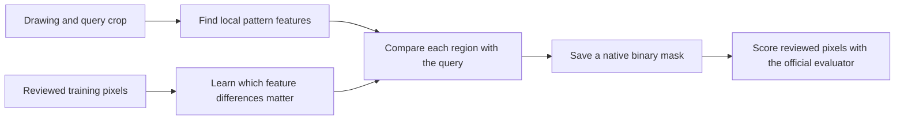

# Hatch matching system

## Goal and completion gates

Build reproducible label-free inference for the TruTec Hatch Matching Challenge. Public validation must measure at least 0.75 document-macro IoU and at least 0.95 pooled recall, with precision and reviewed-blank false positives reported. Private-test results require organizer evaluation and must remain separate. Do not change the upstream evaluator, dataset, annotations, or exclusions. Predictions must be binary PNGs at native dimensions for every request.

Use compute-box for training and inference. Fireworks spending may not exceed $50; record actual charges before claiming budget use. Pretrained models and external training data are allowed subject to licensing and disclosure. Prepare a submission email draft; do not send it or push without authorization.

## Plan

1. Verify upstream contracts, dataset integrity, hardware, and CLI access. Inspect training examples and annotation coverage before choosing a model.
2. Research relevant external models and datasets with license evidence. Establish a measured classical texture baseline and a document-separated training development split.
3. Improve the baseline from measured errors. Compare pretrained texture features and a learned query-conditioned matcher where evidence warrants them. Record each experiment's configuration, data use, runtime, metrics, success, failure, and pivot.
4. Freeze the selected pipeline and run all 57 public validation queries with the unchanged evaluator. Report all scores and counts, disclose any validation-guided development, and keep working if either performance gate fails.
5. Verify inference integrity, type checks, meaningful tests, and complexity <=15 for new code. Save artifacts, reproducibility instructions, visual failure cases, licenses, and email draft. Commit verified features locally. Clean up agent and compute processes.

| Task | Model tier and owner |
|---|---|
| External model and training-data research | Gemini CLI and Cursor/Grok |
| Dataset inspection, baseline implementation, experiment utilities, tests | Cursor/Grok and Gemini CLI |
| Architecture, trust boundaries, experiment selection, independent verification | GPT Sol coordinator |
| Repetitive runs and measurement | Python on compute-box |

## Verified state

- Upstream revision: `65b98e480f2a10b82f974f4feb519ee4e012d66c`; isolated branch `codex/hatch-matching-system`.
- The scorer uses only reviewed pixels, excludes query/context rectangles, and averages query IoU within documents before averaging documents. Unknown pixels cannot establish whole-sheet accuracy.
- Local Gemini 0.63.0 and Cursor agent 2026.10.01-e373342 launch successfully. Cursor advertises Grok 4.7 and Gemini models; authenticated inference is still to be verified.
- compute-box is reachable over SSH. It is an arm64 Mac with 16 GiB RAM, 8 logical CPUs, and about 19 GiB free storage. Its noninteractive PATH exposes only system Python; runtime discovery is next.
- Public dataset download started with the official checksum-verifying downloader.

## Checkpoint 1: data, hardware, and research

- Official dataset download completed locally and was transferred to compute-box; both copies pass the upstream file checksum verification (734 entries).
- compute-box: Apple M1 Pro, 14 GPU cores, 16 GiB RAM, macOS 26.3. PyTorch 2.14.1 reports MPS available. Installed isolated Python 3.11.16 runtime and inference/test dependencies; no paid compute provisioned.
- Upstream checks on compute-box: `RUN_IMAGE_TESTS=1 .venv/bin/python -m pytest -q` passed 16 tests plus 29 subtests, with no image-test skips.
- Deterministic training-only development split: fitting 357 queries / 105 document groups; development 91 queries / 21 groups; real-only development 55 queries / 12 groups. No overlap. Public validation has not been used for model selection.
- Inspected 24 real training queries with positive and negative examples. Patterns include gray fills, directional lines, crosshatch, hexagons, dots, irregular marks, and queries overlaid by text/boundaries. This motivates complementary patch and texture features.
- Failure: standalone Gemini CLI requests fail with `IneligibleTierError` because the Code Assist client is no longer supported. Pivot: Gemini 3.8 Flash High via Cursor, as explicitly requested by the user. The research task completed; learned-matcher implementation is assigned to the same model.
- Cursor/Grok 4.7 High is researching external datasets and implementing native texture/template features in separate file ownership scopes. CLI logs retained under `agent-logs/`; model-provider costs are not yet available, and no dollar cost is invented. Fireworks spend: $0.
- Reviewed Gemini research against primary sources. Corrected benchmark/task mismatches and unsupported guarantees in `RESEARCH_REVIEW.md`. Research accuracy does not count as challenge performance.

## Experiment record

No model performance has been measured yet. No performance target is achieved.

## Checkpoint 2: pretrained candidate and MPS correction

- Grok research found HatchFinder, a reference-conditioned hatch segmentation model. Independently verified Apache-2.0 code and weights, pinned revisions, byte length, and SHA-256; provenance recorded in `external-resources.json`.
- Original 3.5M model loads on compute-box and produces finite 256x256 logits with a 48x48 query on MPS. This is a plumbing smoke test, not accuracy evidence.
- Failure: native 36x36, 46x46, 48x64, and 32x48 query crops fail MPS adaptive pooling. 72x72 succeeds. Changing crop size/pitch to bypass the failure would change the query distribution.
- Fix: extend the pinned library's matching-vector layer in `hatchfinder_mps.py`; only nondivisible query pooling executes on CPU, preserving the original adaptive-pooling operation. Drawing features remain on MPS. Two CPU/MPS equivalence and gradient tests pass; mypy passes; maximum function complexity is 5.
- Gemini 3.8 Flash High is implementing the learned texture matcher/training/inference/tests. Grok 4.7 High is implementing native template/texture features and the pretrained tile adapter. Real training and challenge inference have not started; no score is claimed.

## Checkpoint 3: verified baseline implementations

- Grok finished native template matching and 46-channel phase-invariant texture descriptors. Gemini finished the learned pair classifier, training script, label-free inference, and tests. File ownership remained separate.
- On compute-box, 22 baseline/learning tests and 12 subtests passed. Mypy passed all four matcher modules; maximum function complexity is 8. The core matcher never opens annotations; only the training/evaluation programs consume reviewed domains.
- The MPS bridge successfully processed a real 36x36 development query on a native 896x896 tile, producing finite logits. The smoke forward took 0.895 seconds and reported 5,992 MB MPS driver allocation at that point; this is neither peak resident memory nor a complete-query runtime.
- Local commit `e5cb021` records verified model download/integrity and MPS compatibility. No push. Research-derived trained weights remain a candidate until measured.

Training annotations feed model fitting and scoring, never the inference input path.
