# Hatch matching: how v14 was built

Give it a drawing and a small box around one hatch pattern. It returns a mask of every region drawn with that same pattern.

| Public validation (57 queries, 13 documents) | v14 |
|---|---:|
| Document-macro IoU | **0.908** |
| Recall | 0.974 |
| Precision | 0.742 |
| Reviewed-negative FPR | 0.056 |

TruTec's stated aspiration is 0.75+ IoU with recall near 0.95 ([BENCHMARK.md](BENCHMARK.md)).

## The task


Hatches mark materials. One sheet can hold many similar patterns, with text and dimension lines printed over them.

## The pipeline

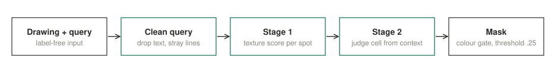

Two gradient-boosted tree models, CPU only. No neural network, no pretrained weights.

## Clean the query first

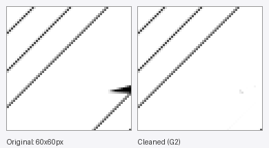

Arrowheads and text inside the query box would otherwise be matched as if they were the pattern.

## Train stage 2 on honest scores

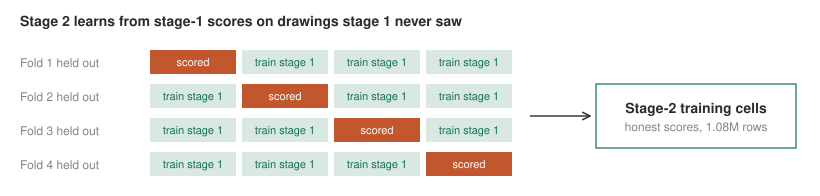

If stage 2 learned from stage-1 scores on drawings stage 1 had memorised, it would trust them too much.

## Make the model bigger, not the rules cleverer

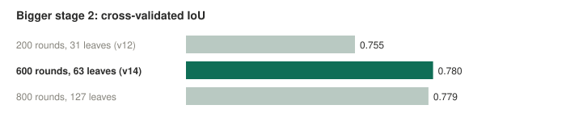

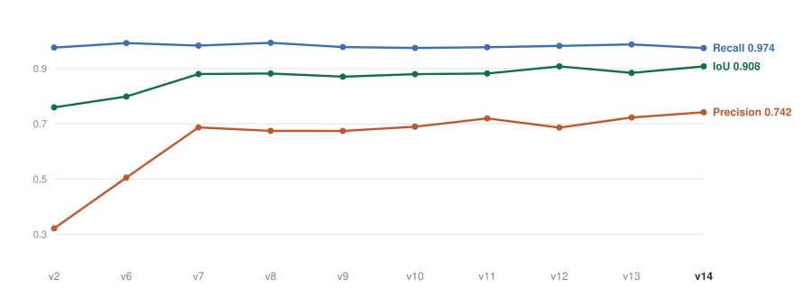

Hand-written rules (v8 to v10) improved development scores and then tied on validation. More real data (v11, v12) and a bigger stage 2 chosen by cross-validation (v14) moved validation.

## Real data beats invented data

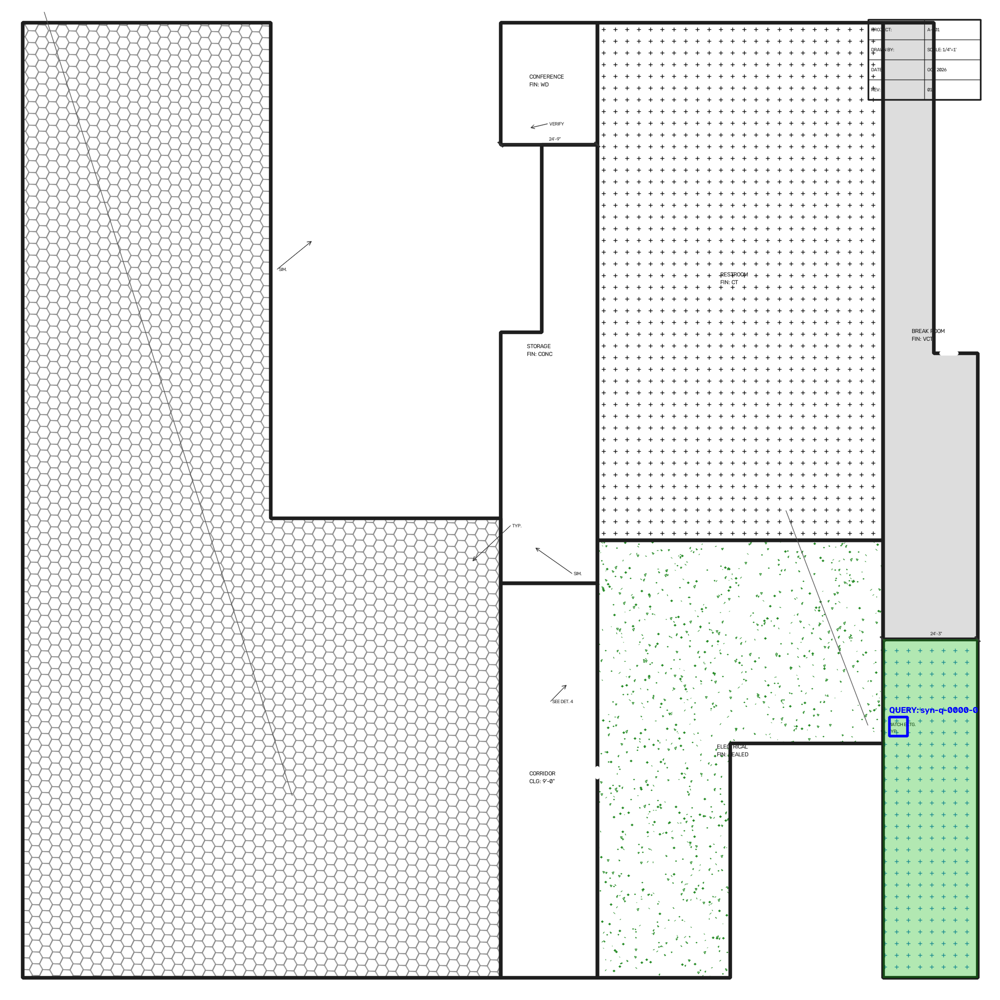

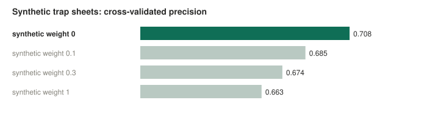

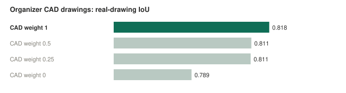

Our 600 synthetic trap sheets hurt (v13). The organizer's generated CAD drawings help, so they stay at full weight.

## Where it still fails

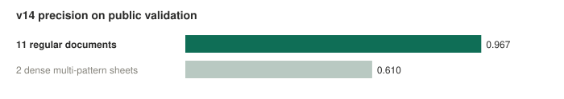

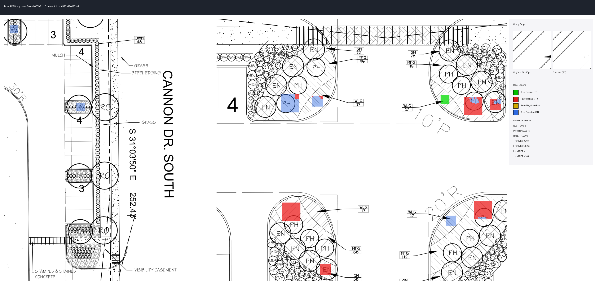

Most errors are neighbouring regions drawn with a near-identical hatch for a different material.

## Validation examples

Left: drawing with the query box (orange). Middle: prediction. Right: green correct, red false positive, blue missed, grey correctly empty, uncoloured unscored.

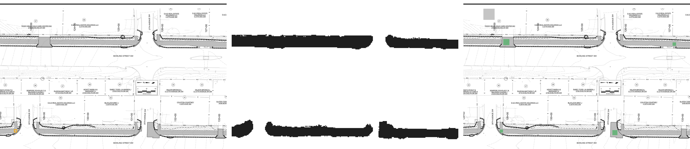

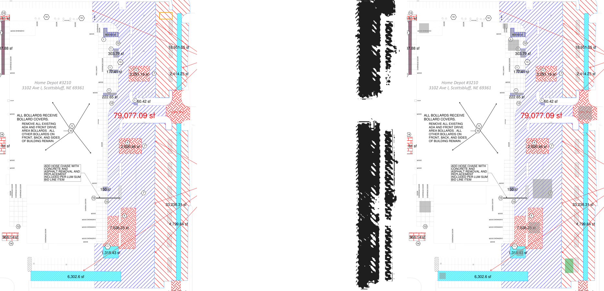

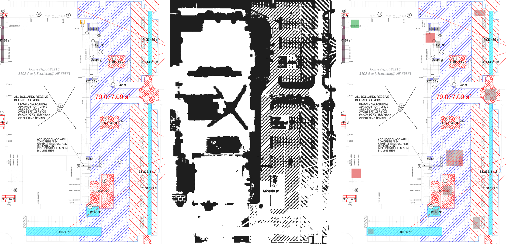

## Run it

```bash
python3.11 -m venv .venv
.venv/bin/python -m pip install -r requirements-inference.txt
curl -L -o models-v14.zip https://github.com/Imhaohao/trutec/releases/download/v14/models-v14.zip
unzip models-v14.zip -d models/v14
.venv/bin/python infer_v14.py --inputs artifacts/validation-inputs.json --data-root dataset --output-dir predictions
.venv/bin/python evaluate.py --manifest dataset/val.json --data-root dataset --predictions predictions --output metrics.json
```

A full rerun reproduces all 57 validation masks pixel for pixel. Rebuild these figures with `python tools/readme_figures.py`.

## Further reading

- [technical-report.txt](technical-report.txt): method, data use, validation exposure, timing
- [PROGRESS.md](PROGRESS.md): every version and experiment, including rejected ones, with numbers
- Challenge: [SPECIFICATION.md](SPECIFICATION.md), [DATASET.md](DATASET.md) (`python download_data.py`), [SUBMISSION.md](SUBMISSION.md)

Drawings and annotations: TruTec Hatch Matching Challenge dataset-v1 ([DATA_TERMS.md](DATA_TERMS.md)). Code: [MIT](LICENSE).
